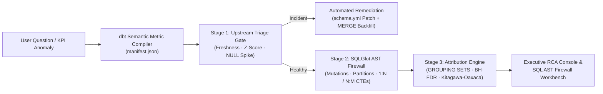

# MetricPulse — Autonomous Enterprise Metric Investigator & RCA Platform

**MetricPulse** is an autonomous Root-Cause Analysis (RCA) platform and semantic SQL firewall built on **`dbt-core`**, **`DuckDB`**, **`SQLGlot`**, **`FastAPI`**, **`FastMCP`**, and **`React`**.

Instead of running a single naive Text-to-SQL query, MetricPulse compiles metric investigations from `dbt`'s `target/manifest.json` and executes a deterministic 4-stage verification pipeline:

1. **Stage 1 — Upstream Pipeline Triage Gate & Automated FDE Remediation:** Walks `dbt` lineage (`parent_map`) upstream before running business attribution to check freshness SLAs, trailing 30-day row-volume $z$-scores, and `NULL`-rate spikes. Halts false business alarms when an upstream ingestion job breaks and synthesizes a PR-ready `dbt` `schema.yml` contract patch + idempotent `MERGE` backfill script.
2. **Stage 2 — `SQLGlot` AST Firewall & Join-Cardinality Compiler:** Inspects every query's AST against `manifest.json` primary keys to block DDL/DML mutations, enforce partition-column pruning, repair `LEFT JOIN` `WHERE`-clause null-rejection traps, and rewrite **`1:N` join fan-outs** and **`N:M` chasm traps** into grain-aligned CTEs—with DuckDB `EXPLAIN` verification and multi-dialect transpilation (`DuckDB`, `Postgres`, `Snowflake`, `BigQuery`).
3. **Stage 3 — `GROUPING SETS` Attribution, Benjamini-Hochberg FDR & Simpson's Paradox:** Slices across valid dimensional hierarchies in a single guarded query, computes Contribution-to-Change, suppresses small-sample noise via two-proportion $z$-tests + Benjamini-Hochberg FDR ($q \le 0.05$), and runs **Kitagawa-Oaxaca** mix-shift decomposition to catch Simpson's Paradox.
4. **Stage 4 — Executive RCA Console, SQL AST Workbench & MCP Server:** Interactive `dbt` lineage health DAG, Contribution Waterfall, Verified SQL & Grain Proof drawer, live SQL AST Firewall Workbench, SSE execution telemetry, and a `dbt-mcp`-aligned FastMCP server.

---

## Architecture



---

## Verifiable Enterprise Scenarios

| Scenario | Prompt | Root Cause / Guardrail Action |
| :--- | :--- | :--- |
| **1. Localized Product Bug** | *"Why did EU Checkout Conversion drop 19% this week?"* | Triage passes (`HEALTHY`). BH-FDR (`1/24` cohorts significant, `q < 0.0001`, `z = -17.13`) isolates `EMEA + iOS Safari + Adyen_3DS + v2.14`. |
| **2. Silent Pipeline Outage** | *"Why did Enterprise DAU crash 42% yesterday?"* | Halts attribution; pinpoints `stg_telemetry_eu` (`16.0h` lag vs `4h` SLA, `z = -26.72`, `68.0%` `session_id` NULL spike) and emits `dbt` contract patch + `MERGE` backfill. |
| **3. `1:N` Join Fan-Out Trap** | *"What is total Net Revenue for accounts with support tickets in Q3?"* | Blocks naive join (`$1,421,200`, `3.4x` inflation) and rewrites to deduplicated CTE `t_dedup` returning verified **`$418,000`** across `140` accounts. |
| **4. Simpson's Paradox** | *"Why did overall trial-to-paid conversion fall while both Self-Serve and Enterprise rose?"* | Kitagawa-Oaxaca decomposition separates `+1.26pp` within-segment rate gain from `-3.74pp` viral Self-Serve mix-shift. |

---

## Quickstart

### 1. Backend & Embedded `dbt` Warehouse Setup
```bash
uv venv --python 3.12 .venv
uv pip install --python .venv/bin/python dbt-core dbt-duckdb duckdb sqlglot fastapi "uvicorn[standard]" pydantic pytest httpx mcp

# Seed 150 days of deterministic SaaS/E-Commerce data into metricpulse.duckdb
PYTHONPATH=. .venv/bin/python backend/seed_warehouse.py

# Compile manifest.json and build staging/intermediate/marts models
cd dbt_project && ../.venv/bin/dbt build --profiles-dir . && cd ..
```

### 2. Build Frontend & Launch Server
```bash
cd frontend && npm install && npm run build && cd ..
PYTHONPATH=. .venv/bin/uvicorn backend.main:app --host 127.0.0.1 --port 8475
```
Open `http://127.0.0.1:8475` for both the **Executive RCA Console** and the **SQL AST Firewall Workbench**.

### 3. Run Automated Tests
```bash
PYTHONPATH=. .venv/bin/pytest -v tests/test_metricpulse_e2e.py
```

### 4. Run as an MCP Server
```bash
PYTHONPATH=. .venv/bin/python backend/mcp_server/server.py
```
Exposes `get_metric_lineage`, `inspect_model_grain`, `run_guarded_sql`, and `investigate_metric`.

---

## Project Structure

```text
metricpulse/
├── dbt_project/                   # dbt-duckdb project (staging, intermediate, marts + grain/SLA meta)
├── backend/
│   ├── main.py                    # FastAPI app + SSE stream + SQL Workbench API
│   ├── seed_warehouse.py          # Deterministic DuckDB data generator
│   ├── lineage/manifest_graph.py  # dbt manifest.json DAG + sqlglot column lineage
│   ├── triage/
│   │   ├── pipeline_gate.py       # Freshness SLA, volume z-score, NULL-spike gate
│   │   └── remediation.py         # dbt schema.yml patch + idempotent MERGE generator
│   ├── firewall/sqlglot_guard.py  # AST safety, partition guard, 1:N / N:M CTE rewriter, LEFT JOIN repair
│   ├── engine/
│   │   ├── semantic_compiler.py   # Schema-driven NL -> InvestigationPlan compiler
│   │   ├── attribution.py         # GROUPING SETS, BH-FDR q-values, Kitagawa-Oaxaca
│   │   └── investigator.py        # 4-stage RCA orchestrator
│   └── mcp_server/server.py       # FastMCP server aligned with dbt-mcp conventions
├── frontend/                      # Vite + React + TypeScript + Tailwind dashboard
└── tests/test_metricpulse_e2e.py  # Unit & E2E verification suite
```
